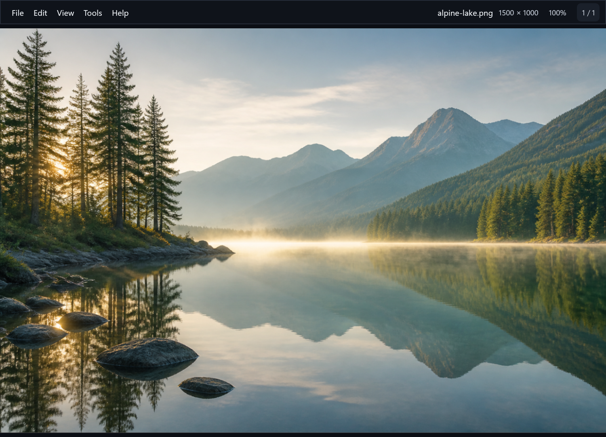

# viewr

**Fast, private photo viewing on Windows, macOS and Linux.**

[](https://github.com/blisspixel/viewr/actions/workflows/ci.yml)

Open a photo or a whole folder and move through it. Make light edits without
leaving the viewer: crop, rotate, fix a small blemish with Spot Heal, and save
a copy. Cull as you go: rate JPEG keepers from 1 to 5, written into the file as
standard XMP so other apps can read them, and send the rest to Trash with Undo.
It is native Rust, with no account, no telemetry, and no application network
client.

The published v0.7.8 preview does not open camera RAW. On main, a DNG
or Sony ARW file shows its largest decodable embedded baseline JPEG
and labels that size as a preview. The sensor image stays unread.
A DNG or ARW with no such preview, and every other camera RAW type,
still says that viewr does not open camera RAW files yet. Full sensor
RAW remains
[#185](https://github.com/blisspixel/viewr/issues/185).

## View, edit, cull

Open a folder with `Ctrl/Cmd+Shift+O`, or drop it. Left and Right move through
the folder. Home and End jump to the ends. `1` through `5` rate a JPEG, and
`0` clears that rating. Delete moves the current image to Trash, and `U`
undoes that Trash action. View's rating filter limits this session to a
minimum star count. `Ctrl/Cmd+Shift+S` saves a copy.

## Why viewr

Tired of photo software that wants to become a cloud library, storefront, and
subscription? viewr keeps the photo at the center, without a catalog, cloud
library, or subscription.

- **Fast by design.** Decoding begins while the window initializes, neighboring
  images are prefetched within fixed memory limits, extra cores fill those slots,
  and performance budgets run in CI. On 2026-10-23 a Windows development host
  recorded a 1.28 ms median for the 640 by 480 `mem_b.png` row of
  `viewr benchmark` with no folder argument, which measures the in-memory corpus.
- **Private by construction.** The application dependency graph contains no HTTP
  or TLS client. Photos, paths, metadata, ratings, and diagnostics stay local.
  Local network shares (NAS, SMB, NFS) are accessed through standard operating-system
  file paths without an application network client. No tracking is literal:
  there is no account, cloud service, telemetry, analytics, advertising,
  background indexer, activity history, crash-report uploader, or automatic
  update check.
- **Focused, not bare.** Folder navigation, ratings, rotation, crop, bounded Spot
  Heal, Save As, and conversion are intentional core viewer tools. Deeper work
  stays with an editor you choose through native Open With, without adding a
  catalog or subscription.
- **Cross-platform.** The same Rust codebase is built and tested on Windows,
  macOS, and Linux, with native dialogs and shortcuts, accessible menus, and
  accessibility semantics.

## Check it yourself

These are checks you can run. They are not a promise beyond the startup policy
in [Privacy](docs/PRIVACY.md). Watch the `viewr` process. The installer scripts
are separate tools and contact GitHub only after you run them.

- **Linux, run on 2026-11-16.** `strace -f -e trace=network viewr <folder>`
  showed Unix-domain sockets for the display and the session bus. The Internet
  socket call returned `EPERM`.
- **macOS, not run for this note.** Watch the process in `nettop` or a firewall
  app while browsing a folder.
- **Windows, not run for this note.** Open Resource Monitor, choose the Network
  tab, and filter to `viewr.exe` while browsing a folder.

## Interface

### Dark



The PNG is a programmatic application-only capture of a repository-safe
demonstration image, with no private path or unrelated desktop content.
Appearance and panel behavior are detailed in the
[interface design guide](docs/DESIGN.md).

## Install

v0.7.8 is the preview described here. Its portable archives are checksummed and
attested, but they are not Authenticode-signed on Windows or notarized on macOS.
Normal operating-system trust warnings may appear. Do not disable platform
security controls to force a launch. The representative-hardware product-quality
matrix was not completed for this tag; the
[v0.7.8 notes](docs/releases/v0.7.8.md) record that gap exactly.

### Windows 10 or 11, x64

```powershell
irm https://github.com/blisspixel/viewr/releases/download/v0.7.8/install.ps1 | iex
```

viewr installs for the current user under `%LOCALAPPDATA%\Programs\viewr`, adds
that directory to the user PATH, and creates a Start menu shortcut. No elevation
or updater service is required.

### macOS or Linux

```sh
curl -fsSL https://github.com/blisspixel/viewr/releases/download/v0.7.8/install.sh | sh
```

viewr installs under `~/.local`. The preview supports Intel and Apple Silicon
macOS plus x86-64 glibc Linux. The published v0.7.8 Linux archive needs
glibc 2.43, so Ubuntu 24.04 LTS (glibc 2.39) and Debian 13 (glibc 2.41)
cannot run it. On those systems, install v0.7.7 with `VIEWR_VERSION=0.7.7`.

The command downloads the immutable v0.7.8 installer script. That script
installs the newest stable release unless you set a version, and it verifies
the archive SHA-256 sidecar and internal manifest before installation. It does
not give the application network access. Run the same command again to install
the newest stable release. To install v0.7.8 itself, set `VIEWR_VERSION=0.7.8`
before `sh` on macOS or Linux, or save the PowerShell script and run it with
`-Version 0.7.8`. For review-first installation,
manual archive verification, uninstall steps, platform prerequisites, or a source
build, see [Installing viewr](docs/INSTALL.md).

The v0.7.8 archive uses the `io.github.blisspixel.viewr` desktop ID.
Existing source installs should follow the launcher's
[identity migration steps](docs/INSTALL.md#linux-identity-migration).

## What it does

The published v0.7.8 preview does the following. Behavior on main since
that tag is named in Project status and the changelog. It is not in the
archives above.

- Opens JPEG, PNG, GIF, WebP, TIFF, SVG, JPEG XL, OpenEXR, and common bitmap
  formats, including bounded animation and multi-page image navigation.
- Browses folders Latest First by default or in saved natural filename order,
  while keeping the selected image and last good frame stable.
- Provides GPU pan, zoom, fit, rotation, crop, bounded Spot Heal, Save As, and
  conversion. Edits stay in memory until Save As writes a copy; the original is
  left untouched.
- Stores standard 0-to-5 XMP ratings in supported JPEG files and filters the
  current folder without creating a catalog or sidecar.
- Shows up to 12 complete photos in a dense, aspect-aware full-image collage.
  Large photos use bounded display images in the collage; opening one loads its
  full-resolution source.
- Shows a presence-only Source Privacy summary and strips supported metadata from
  saved copies by default.
- Uses native Open With, system Trash with receipt-bound Undo, and explicit
  confirmation for permanent deletion.
- Keeps file associations opt in. File > Default Image Viewer explains how to
  choose viewr per format on Windows, macOS, and Linux.
- Follows the operating-system language by default, with offline English,
  Spanish, French, and German choices in File > Preferences.
- Offers native dialogs, keyboard-first controls, AccessKit semantics, four chrome
  appearances, and independent image-inspection backgrounds.

See [Design](docs/DESIGN.md) for interaction details,
[Formats](docs/FORMATS.md) for the exact format table,
[Ratings](docs/RATINGS.md) for the write-safety contract,
[Localization](docs/LOCALIZATION.md) for language behavior, and
[Roadmap](docs/ROADMAP.md) for implemented behavior and remaining work.

## Privacy and security

viewr sends no photos, filenames, paths, metadata, diagnostics, ratings, or usage
data anywhere. Normal runs initialize no logger and create no logs. Explicit
developer-only console diagnostics are opt-in, path-private, local, and never
written to a log file. Optional C-backed image formats execute in a bounded helper
that receives encoded bytes rather than a filesystem path, and platform packages
add network-denied sandbox profiles.

Opening an image still means parsing untrusted data. The codebase uses bounded
decoding, allocation limits, source-identity checks around destructive operations,
fail-closed metadata writes, dependency policy, fuzzing, and native platform
tests. The precise boundaries are in [Privacy](docs/PRIVACY.md),
[Architecture](docs/ARCHITECTURE.md), and the [Security Policy](SECURITY.md).

Installer scripts are separate foreground tools. They contact only the official
GitHub repository after the user runs them. viewr itself never checks for updates
automatically.

## Essential controls

An editable image or folder path is available on the empty card
and File > Open Path while viewing. Enter opens it; a missing path stays editable
with a complete inline explanation. A native chooser that returns no selection
points to these alternatives. Path input stays in memory for this session.
If a native chooser does not appear on your desktop, use the path field or
File > Open Path to keep opening images and folders.
File > Save Path types a destination for a copy. The field starts with the
suggested JPEG name beside the open file, and Enter uses the same overwrite
check as the chooser. A chooser that returns no destination shows where to type
one and does not write a file. That destination stays in memory for this session.

File > Exit (Quit viewr on macOS) uses Ctrl+Q or Cmd+Q. Interface type uses
installed platform fonts, with bundled fallbacks. Console uses softer
phosphor-green text and selection outlines.

Image view uses a compact open-hand cursor and direct drag-to-pan, with a
closed hand while dragging. The zoom percentage opens Fit, Actual Size, and
zoom controls. Windowed Fit fills the frame. View can cap Fit at actual size
for the session, and that choice is not saved. Pan limits keep part of the
photo reachable. Fullscreen starts at Fit and enlarges small images to the
available screen area; Actual Size remains available for exact pixel inspection.

| Action | Control |
| --- | --- |
| Open file | `O`, `Ctrl/Cmd+O`, or drop a file |
| Open folder | `Ctrl/Cmd+Shift+O`, or drop a folder |
| Open typed path | Empty-card Image or folder path field, or File > Open Path; Enter opens |
| Paste path | `Ctrl/Cmd+V` |
| Copy image | Right-click, Edit > Copy, or `Ctrl/Cmd+C` |
| Previous or next image | Left/Right, Home/End, Page Up/Page Down |
| Folder order | File > Preferences or View > Folder Sort; Latest First is the initial default |
| Interface language | File > Preferences; System is the initial default |
| Previous or next page or frame | `[` / `]` |
| Pan | Drag the image; hold Space for temporary pan in Crop or Spot Heal |
| Fit or actual size | Space tap fits; double-click toggles Fit/100%; `Ctrl/Cmd+0` / `Ctrl/Cmd+1` |
| Fullscreen | `F` or `F11`; Escape leaves after crop and Spot Heal |
| Full-image collage | Up or `Shift+G` enters at 4 photos; Up steps to 9, then 12; Down steps back, then opens; Left/Right selects; Enter or click opens; Page Up/Page Down moves by the current level; Delete stays in the group; `Shift+G` or Escape leaves |
| Zoom | `+`, `-`, wheel or trackpad; wheel zoom stays anchored under the pointer |
| Browse with the mouse | Back/Forward side buttons |
| Tools, folder previews, image information | `T`, `G`, `I` |
| Rate or clear rating | `1` through `5`, `0` |
| Crop or Spot Heal | `C`, `J` |
| Reload after an external edit | `F5` |
| Save As | `Ctrl/Cmd+Shift+S` |
| Exit | File > Exit or Quit viewr; `Ctrl/Cmd+Q` |
| Move current image to Trash | Delete |
| Undo the latest recoverable Trash action | `U` |
| Keyboard shortcuts | `?` or `F1`, or Help > Keyboard Shortcuts |

Menus expose the same actions and shortcuts. There is no flag, review queue,
batch-trash mode, or bare-letter delete shortcut. Detailed interaction behavior is
in [Design](docs/DESIGN.md) and [Accessibility](docs/ACCESSIBILITY.md).

Ratings write 0-to-5 into ordinary JPEG files as standard XMP. Scope, states,
and the write-safety contract are in [Ratings](docs/RATINGS.md).

## Appearance

- **System** follows the operating system's light or dark setting and supported
  high-contrast preference.
- **Light** uses bright neutral chrome.
- **Dark** uses low-glare charcoal chrome.
- **Console** uses near-black chrome, phosphor-green text, and monospace type.

Image Background independently offers Theme Default, Black, Neutral Gray,
White, and a session-only Checkerboard. Appearance changes interface chrome
and canvas only, never image pixels. Canvas colors match the specified
appearance palette.
Windows Text size and GNOME text scaling enlarge the interface when the window
has room; image zoom does not change.

## Project status

v0.7.8 adds named missing-format opens, damaged WebP, TIFF, and ICO reports,
JPEG end-marker rejection, version-command help, benchmark path errors, stable
folder order, AppleDouble skipping, and the installer-script explanation to the
focused viewer. The representative-hardware and screen-reader acceptance rows
remain open; this patch does not complete the v0.8 release-readiness milestone.
Behavior on main since that tag is under Unreleased in
[CHANGELOG.md](CHANGELOG.md). It includes the labelled DNG and Sony ARW
embedded preview, opening a folder on the first photo that can be shown,
JPEG ratings that put the previous modification time back, the shortcut
list from Help, `?`, and F1, and a rating message that leaves when the
visible photo changes. The window and controls use wgpu 30 and egui 0.37.
Pictures stay on the historical sRGB surface. Those changes are in this
source tree. They are not in the v0.7.8 archives, and the install
commands above stay on that tag.

The first preview v0.1.0, the v0.1.1 through v0.1.5 patches, v0.2.0, v0.3.0,
v0.4.0, v0.5.0, v0.6.0 through v0.6.5, and v0.7.0 through v0.7.7 remain
published. `main` continues the logical order in the
[roadmap](docs/ROADMAP.md#order-of-operations-to-10): **v0.8.0** release
readiness through v0.9 publisher authentication, then v1.0.
The [current release notes](docs/releases/v0.7.8.md) state the exact published
limits, including that the representative-hardware product-quality matrix was
not completed for this tag and that its rows remain open work.
Unpublished candidates are identified by exact commit and workflow run. The
[publishing guide](docs/PUBLISHING.md#version-state-policy) defines when the
workspace version, release documents, and public install links advance.

## Development

The repository pins its Rust toolchain and lockfiles. The normal local gate is:

```text
cargo fmt --all -- --check
cargo clippy --workspace --all-targets --locked -- -D warnings
cargo test --workspace --all-targets --locked
```

CI also enforces at least 85 percent meaningful logic coverage, Python
release-tool tests, dependency license and advisory policy, privacy tripwires,
fuzz targets, platform sandbox profiles, native accessibility, deterministic
release archives, and GUI performance budgets. Read
[Contributing](CONTRIBUTING.md) and [Verification](docs/VERIFY.md) before
submitting a change.

The [documentation index](docs/README.md) links every user, architecture,
quality, privacy, and release document. [CHANGELOG.md](CHANGELOG.md) records
user-visible changes.

## License

viewr is licensed under the [Apache License 2.0](LICENSE), including its express
patent grant and standard warranty disclaimer. [NOTICE](NOTICE) identifies the
project distribution. Third-party components retain their own licenses, collected
in [THIRD_PARTY_LICENSES.txt](THIRD_PARTY_LICENSES.txt).
